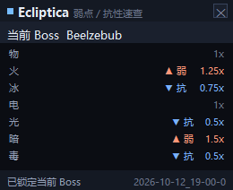
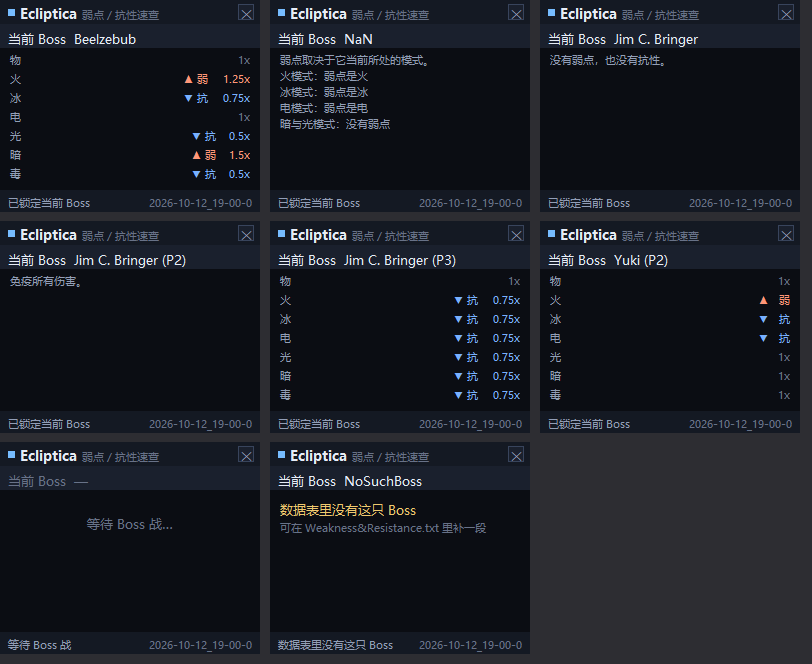
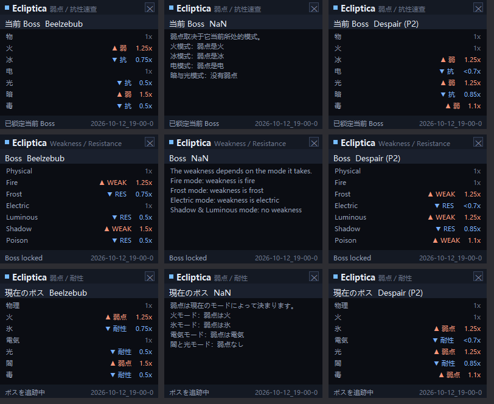

# Ecliptica HUD DLC — Boss 弱点 / 抗性速查

[本体程序](../README.md) 的一个**独立DLC**：它跟随同一份 VRChat 日志，
认出**当前正在打哪只 Boss**，然后把 `Weakness&Resistance.txt` 里对应的
**弱点 / 抗性**显示成一小块置顶面板。

> **这是一个独立程序**，不修改、也不依赖本体 `ecliptica-hud-c.exe`。
> 两个程序可以同时开，各自读同一份日志，互不影响。



---

## 目录

- [它做什么](#它做什么)
- [构建](#构建)
- [使用](#使用)
- [数据文件格式](#数据文件格式)
- [工作方式](#工作方式)
- [测试与验证](#测试与验证)
- [已知限制](#已知限制)
- [许可证](#许可证)

> 🌐 **语言 Language 言語**：
> [简体中文](README.md) · [English](README.en.md) · [日本語](README.ja.md)

---

## 它做什么

打 Boss 的时候最常问的一句话是"我这套属性打它疼不疼"。这个面板把答案放在屏幕角落：

```
当前 Boss  Beelzebub
物            1x
火         1.25x  ▲ 弱
冰         0.75x  ▼ 抗
电            1x
光          0.5x  ▼ 抗
暗          1.5x  ▲ 弱
毒          0.5x  ▼ 抗
```

七种属性在面板上显示为**中文单字**：**物**（Physical）、**火**（Fire）、
**冰**（Frost）、**电**（Electric）、**光**（Luminous）、**暗**（Shadow）、**毒**（Poison）。

- **▲ 弱**（倍率 > 1）用暖色标出，**▼ 抗**（倍率 < 1）用冷色，`1x` 是中性灰
- 面板置顶、半透明、不抢焦点，可以拖到任意位置
- Boss 一换，面板立刻跟着换（切换瞬间 Boss 行会闪一下）
- 位置和透明度记在 `hr-dlc.ini`，下次启动沿用

## 构建

需要 MinGW-w64（或 MSVC），无第三方依赖。

**MinGW-w64**

```bat
mingw32-make                 :: 中文（默认）-> hr-dlc.exe
mingw32-make LANG=en         :: 英文        -> hr-dlc-en.exe
mingw32-make LANG=ja         :: 日文        -> hr-dlc-ja.exe
```

**MSVC**（在 `x64 Native Tools Command Prompt for VS 2022` 中）

```bat
build.bat            :: 中文
build.bat en         :: 英文
build.bat ja         :: 日文
```

产物是 GUI 子系统的 exe，无控制台窗口。

顺带说明：因为 exe 文件名里带 `-`，在部分 shell 里直接敲 `hr-dlc` 会被当成参数，
写 `.\hr-dlc.exe` 最稳。

### 多语言版本

界面文案有**简体中文 / English / 日本語**三套，共用同一份源码，
只有 `uitext_*.h` 不同，构建时用 `LANG` 选择：

| 语言 | 主程序 | 测试 / 预览工具 | 文案表 |
|---|---|---|---|
| 简体中文 | `hr-dlc.exe` | `test_dlc.exe` / `preview_dlc.exe` | `uitext_zh.h` |
| English | `hr-dlc-en.exe` | `test_dlc-en.exe` / `preview_dlc-en.exe` | `uitext_en.h` |
| 日本語 | `hr-dlc-ja.exe` | `test_dlc-ja.exe` / `preview_dlc-ja.exe` | `uitext_ja.h` |

三个 exe 可以放在同一个文件夹里，**共用同一份 `Weakness&Resistance.txt`**
（数据文件里的说明文字用语言前缀区分，见下）。

对应文档：

| 语言 | 说明 |
|---|---|
| 简体中文 | [README.md](README.md) |
| English | [README.en.md](README.en.md) |
| 日本語 | [README.ja.md](README.ja.md) |

实现要点：

- 三种语言共用同一组宏名（`TXT_*`），`uitext.h` 按 `UI_LANG_EN` / `UI_LANG_JA`
  派发到对应文案表，源码里不写死字符串。
- **属性显示名按语言给**（`TXT_ELEM_DISPLAY`）：中文 物/火/冰/电/光/暗/毒、
  英文 Physical/Fire/…、日文 物理/火/氷/電気/光/闇/毒。
  但**数据文件里的解析键与界面语言无关** —— 英文键、中文键、日文键三种语言版都认，
  所以同一份数据文件三个 exe 都能用。
- 中间文件按语言分目录（`build/<lang>/`），切换语言不会串用旧目标文件。

> 新增界面文案时，`uitext_zh.h`、`uitext_en.h`、`uitext_ja.h`
> **三个文件要一起补**，否则对应语言的编译会报未定义。

## 使用

```bat
hr-dlc.exe                       :: 自动定位 VRChat 日志并跟随
hr-dlc.exe --log "D:\...\output_log.txt"   :: 只看指定文件
hr-dlc.exe --boss FlyLord        :: 不读日志，固定显示某只 Boss（调试用）
hr-dlc.exe --demo                :: 内置轮播演示，不需要日志
hr-dlc.exe --help
```

| 参数 | 说明 |
|---|---|
| （无） | 自动定位日志，**先从头扫一遍**确定当前 Boss，再持续跟随 |
| `--log <文件>` | 只用这个文件；文件打不开时每 2 秒重试，不会退回到自动定位 |
| `--boss <内部名>` | 忽略日志，固定显示这一只（内部名，例如 `FlyLord`、`YukiPhase2`）|
| `--demo` | 依次轮播几只代表型 Boss，用来确认面板本身正常 |
| `--help`、`-h` | 显示帮助 |

操作：

| 操作 | 说明 |
|---|---|
| 拖动面板 | 移动窗口，位置自动记住 |
| 点右上 `✕` | 关闭 |
| `Ctrl+Alt+W` | 全局退出（任意窗口焦点下都有效）|

日志定位顺序与本体一致：

1. `%USERPROFILE%\AppData\LocalLow\VRChat\VRChat\` 下最后写入最新的 `output_log*.txt`
2. 上面的目录找不到时，退回 `%LOCALAPPDATA%\..\LocalLow\...`
3. 再退回 exe 同目录 / 当前目录

VRChat 换会话（目录里出现更新的日志文件）时会自动切过去。

## 数据文件格式

数据来自 exe 同目录的 **`Weakness&Resistance.txt`**（UTF-8）。
每个 Boss 一段，段之间用 `---` 分隔：

```
Beelzebub
Physical: 1x
Fire: 1.25x
Frost: 0.75x
Electric: 1x
Luminous: 0.5x
Shadow: 1.5x
Poison: 0.5x
---
```

支持的写法：

| 写法 | 含义 |
|---|---|
| `Fire: 1.25x` | 具体倍率；`>1` 显示为「弱」，`<1` 显示为「抗」 |
| `Fire: 1+x (weak)` | 只说明弱、没给具体倍率，面板显示 `弱 ▲` |
| `Fire: 1-x (resist)` | 只说明抗、没给具体倍率，面板显示 `抗 ▼` |
| `Others: 0.75x` | 其余未单列的元素统一按这个倍率（例如 `Jim C. Bringer(P3)`）|
| 直接写一句话 | 整段没有数值表时，按说明文字显示（例如 `NaN`、`Jim C. Bringer(P1)`）|

**说明文字是按数据文件里的原始行逐行显示的**，不会合并成一整段再重新折行。
`NaN` 那段在文件里是 5 句话，面板上就是 5 行：

```
弱点取决于它当前所处的模式。        <- 这一行本身太长，折出来的续行会缩进
  模式。
火模式：弱点是火
冰模式：弱点是冰
电模式：弱点是电
暗与光模式：没有弱点
```

**说明文字直接写在数据文件里**，所以想显示什么就写什么 —— 面板不会翻译它，
只负责原样显示。

### 说明文字的语言前缀

三个 exe 共用同一份数据文件，而**数值是语言无关的**，只有说明文字需要分语言。
所以说明行可以带前缀 `zh:` / `en:` / `ja:`（小写，冒号后的空格随意）：

```
NaN
zh: 弱点取决于它当前所处的模式。
en: The weakness depends on the mode it takes.
ja: 弱点は現在のモードによって決まります。
zh: 火模式：弱点是火
en: Fire mode: weakness is fire
ja: 火モード：弱点は火
---
```

规则：

- 每个 exe **只收自己语言的行**。中文版看到 5 行中文说明，英文版看到 5 行英文。
- **不带前缀的说明行三种语言都会显示**（所以整份表都是英文的话，三个 exe 都显示英文）。
- 数值部分（`Fire: 1.25x` 那些）不分语言，三种语言版共用同一套。

这样一份数据文件就能同时喂三个 exe，改数值不必改三遍。

### 行内注释

行首或空白之后的 `#` 是注释，注释不会显示：

```
Fire: 1.25x        # 弱
Shadow: 1.5x       # 也是最弱的一项
```

像 `标签#不是注释` 这种紧贴文字的 `#` 属于正文。整行都是注释的行会被跳过，
不会在面板上留下一行空白。

七个元素键固定为 `Physical` / `Fire` / `Frost` / `Electric` / `Luminous` / `Shadow` / `Poison`，
大小写不敏感。**也可以直接写中文键**（三种语言版都认，与界面语言无关）：

| 数据文件里可写 | 中文版显示 | 英文版显示 | 日文版显示 |
|---|---|---|---|
| `Physical` / `物` / `物理` | 物 | Physical | 物理 |
| `Fire` / `火` / `火焰` | 火 | Fire | 火 |
| `Frost` / `冰` / `冰霜` | 冰 | Frost | 氷 |
| `Electric` / `电` / `雷` | 电 | Electric | 電気 |
| `Luminous` / `光` / `圣` | 光 | Luminous | 光 |
| `Shadow` / `暗` / `暗影` | 暗 | Shadow | 闇 |
| `Poison` / `毒` / `毒素` | 毒 | Poison | 毒 |

即：**数据文件里的英文只是"键"**，与界面语言无关；面板显示什么由当前语言的
文案表决定。Boss 名（`Beelzebub`、`Jim C. Bringer` 之类）是专有名词，
三种语言版都沿用数据表里的写法。

**解析规则**（想加段落时需要知道）：

- 没有冒号的行，如果**在文件开头、紧跟在 `---` 之后、或者当前段已经有数值了**，
  就当作新 Boss 的段落名；否则当作当前段的说明文字。
  所以段与段之间**建议保留 `---`**。
- 有冒号但不是元素名/`Others`/语言前缀的行（例如 `Fire mode: weakness is fire`）
  一律当作说明文字。
- 段名就是查询用的键。带形态的 Boss 写成 `名字(P2)` 这种形式。

### 关于形态

日志里同一个 Boss 的不同形态是不同对象名，例如 `Yuki` / `YukiPhase2`，
`JimBringer` / `JimBringerPhase3`。面板的查询规则是：

1. 先把内部名映射成显示名（`FlyLord → Beelzebub`，映射表见 `res.c`）
2. 先查 `显示名(P形态号)`，例如 `Yuki(P2)`
3. 查不到再退回不带形态的 `显示名`
4. 都查不到 → 面板显示「数据表里没有这只 Boss」

所以 `Yuki(P1)` / `Yuki(P2)` 这种按形态分开的条目能精确命中；
只写一个 `Corus` 就能覆盖它的所有形态。

`Jim C. Bringer` 三个形态在表里是三种不同写法，正好各代表一类：

| 条目 | 内容 | 面板表现 |
|---|---|---|
| `Jim C. Bringer(P1)` | `No weaknesses and resistances.` | 单行说明 |
| `Jim C. Bringer(P2)` | `All damage blocked.` | 单行说明 |
| `Jim C. Bringer(P3)` | `Physical: 1x` + `Others: 0.75x` | 数值表 + Others |

如果某个形态在表里确实没有条目（例如新 Boss 还没补），面板会如实显示
「数据表里没有这只 Boss」并提示去哪补。

## 工作方式

```
VRChat output_log.txt
        │  logtail.c   定位 + 从头扫一遍 + 持续跟随
        ▼
   当前 Boss（内部名 + 形态号）
        │  res.c       显示名映射 -> 查表
        ▼
   弱点 / 抗性 条目
        │  dlcui.c     版式计算 + GDI 双缓冲绘制
        ▼
   置顶分层窗口（dlc.c）
```

- **只认三件事**：`now fighting boss:` 开战行、`Boss X dead` 击杀行、
  以及 `now in intermission` / `now in lobby` / `now in stage:` / 进出房间这些"这一场结束了"的信号。
  本体程序做全量解析，这里刻意保持极简，两边互不影响。
- 日志**从头扫一遍**再跟随：HUD 常常是在战斗中途才启动的，只看新增行会不知道当前 Boss。
  扫的是普通文本行，几 MB 的日志也就几十毫秒。
- 版式（标题行 / Boss 行 / 元素表 / 状态栏）由 `dlcui_layout()` 一次算出，
  **绘制与命中测试共用同一份矩形**，不会出现"按钮点不到"。
- 窗口是 `WS_EX_LAYERED | WS_EX_TOPMOST | WS_EX_TOOLWINDOW | WS_EX_NOACTIVATE`，
  不抢 VRChat 焦点。DPI 感知，60%–200% 缩放下版式一致。

## 测试与验证

```bat
mingw32-make test        :: 逻辑测试（127 项检查）
mingw32-make preview     :: 离屏渲染一张面板预览图，无需显示器
```

三种语言各自的测试/预览工具：`test_dlc-en.exe`、`preview_dlc-ja.exe` …（见上表）。

`test_dlc.c` 覆盖：数据表解析（数值 / 符号 / `Others` / 说明型）、
Boss 显示名映射（18 条）、基础名与形态号提取、说明行的语言前缀与 `#` 注释、
以及各种查不到时的返回值。测试本身**不依赖界面语言**：元素显示名只验证
"接上了、七个、互不相同"，具体文字属于各语言的文案表。

`preview_dlc.exe` 可以在没有显示器的环境下渲染任意状态，便于核对排版：

```bat
preview_dlc.exe "Weakness&Resistance.txt" FlyLord 1 100 out.bmp
preview_dlc.exe "Weakness&Resistance.txt" -       1 100 waiting.bmp   :: 没有 Boss 战
preview_dlc.exe "Weakness&Resistance.txt" YukiPhase2 2 100 yuki2.bmp
```

实测覆盖的状态：



|  | 左 | 中 | 右 |
|---|---|---|---|
| **上** | 普通数值段（贝西卜）| 多行说明（NaN）| 单行说明（Jim P1）|
| **中** | 单行说明（Jim P2）| `Others:` 段（Jim P3）| 符号写法（Yuki P2）|
| **下** | 没有 Boss 战 | 表里没有的 Boss | （空）|

| 状态 | 结果 |
|---|---|
| 普通数值段（贝西卜）| 7 个元素 + 弱/抗标记 + 配色正确 |
| `Others:` 段（Jim P3）| 物 1x，其余按 Others 显示 0.75x ▼抗 |
| 符号段（Yuki P2）| 火 显示「弱 ▲」，冰/电 显示「抗 ▼」|
| 多行说明（NaN）| **按数据文件的原始行逐行显示**，只有超宽的行才折行 |
| 单行说明（Jim P1 / P2）| 原文一行就是一行 |
| 没有 Boss 战 | 显示「当前 Boss —」「等待 Boss 战…」|
| 表里没有的 Boss | 提示「数据表里没有这只 Boss」|

面板上除 **Boss 名**（专有名词，沿用数据表写法）外，其余文字都由当前语言的
文案表决定：标题、状态栏、七个属性名，以及数据文件里对应语言的说明文字。

三种语言各自的渲染都核对过：



（上：中文 · 中：English · 下：日本語。数据文件是同一份，
说明文字按语言前缀各取所需。）

`test_dlc.exe --log <日志>` 可以不开窗口就验证"从真实日志认 Boss"这条链路，
**输出跟着当前语言走**，会打印认出哪只、查到的条目、以及每个元素的判定
（中文版还会把显示名和数据文件里的英文键并排打出来，方便对着表改）：

```
===== 截到 QueenBug 开战后 =====
正在打的   : QueenBug
显示名     : Vesra
形态号     : 1
查询键     : Vesra(P1)  /  Vesra
查到条目   : Vesra
  物 Physical       1.00x   -
  火 Fire           1.50x   弱
  ...
```

用真实日志实测过的几例：

| 日志里的 Boss | 显示名 | 结果 |
|---|---|---|
| `Pandora` | Pandora | 7 项数值，火 1.5 弱 / 冰 0.3 抗 … |
| `QueenBug` | Vesra | 名称映射生效，查到 Vesra 段 |
| `ConeHeadPhase2` | Cone Head | 先试 `Cone Head(P2)` 未命中 → 回退到 `Cone Head` |
| `Nan` | NaN | 说明型，7 项显示 `—` + 说明文字 |

## 已知限制

- 只支持 **Windows**（Win32 + GDI）。
- 抗性数据**完全来自那个 txt 文件**；游戏本身不输出这些数值，
  所以数据对不对取决于你是否维护了这个文件。面板只负责"查表 + 显示"。
- 面板上除 **Boss 名**（专有名词）外都会跟着语言走；Boss 名三种语言版
  都沿用数据表里的写法。
- 数据文件的格式解析是**约定驱动**的：段落之间建议保留 `---`，
  七个元素名要按上面的拼写。写错了不会崩，但会显示成"没有这只 Boss"
  或少了某一行。
- 一次只显示一只 Boss；如果世界里同时存在多个 Boss，面板显示日志里最后一条
  `now fighting boss` 的那只。

## 许可证

与本体项目一致，**MIT License**（见 [../LICENSE](../LICENSE)）。
